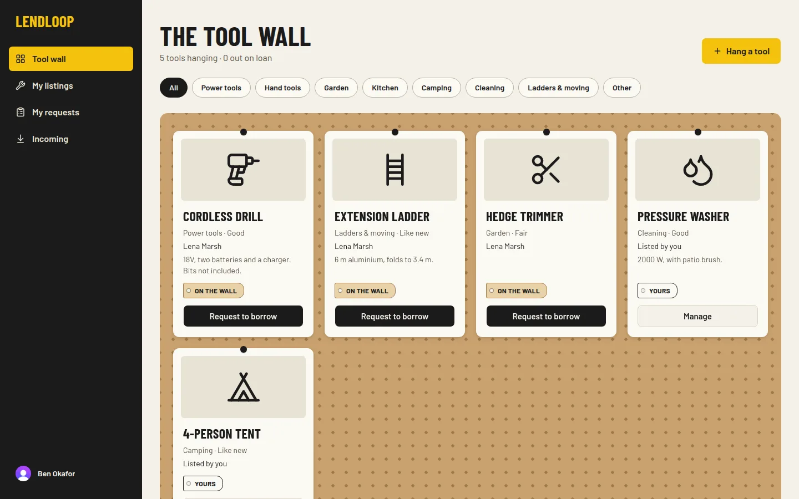
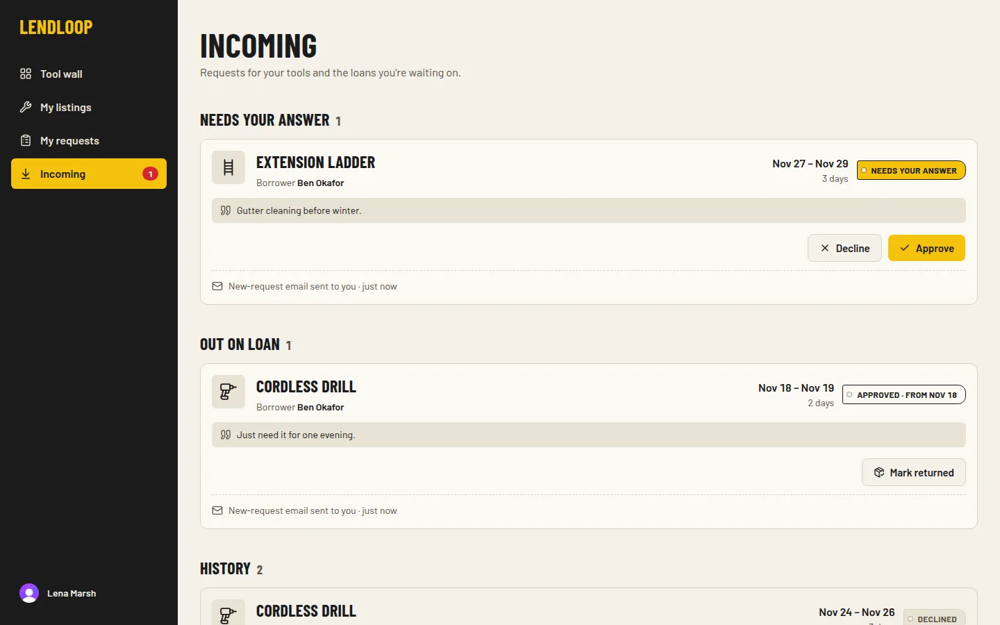
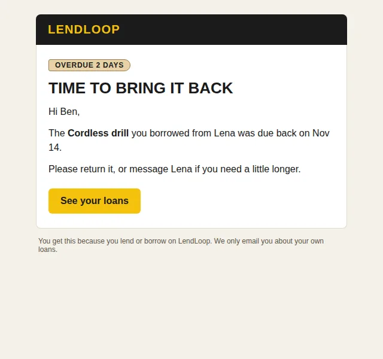

# LendLoop

Borrow what you need. Lend what you don't.

LendLoop is a neighborhood tool-lending board. Neighbors hang tools on a shared wall, others request them for a few days, and the lender approves or declines. Emails go out at every step, and borrowers get a reminder when something is overdue.

**Live demo: https://lendloop-ten.vercel.app**



Built with Next.js (App Router), Clerk, Convex, n8n and TypeScript. Email is sent by n8n through Resend.

## Contents

- [Try the demo](#try-the-demo)
- [Features](#features)
- [Architecture](#architecture)
- [Run it locally](#run-it-locally)
- [Environment variables](#environment-variables)
- [Security and data minimization](#security-and-data-minimization)
- [Design decisions](#design-decisions)
- [Project structure](#project-structure)
- [If this went to production](#if-this-went-to-production)

## Try the demo

You can sign up with your own email or Google account, or use the two demo neighbors. They already have tools, requests and an overdue loan.

| Neighbor | Email | Has |
| --- | --- | --- |
| Lena Marsh | `delivered+lena_clerk_test@resend.dev` | A drill (overdue, borrowed by Ben), a ladder (Ben's request is waiting for her answer), a hedge trimmer |
| Ben Okafor | `delivered+ben_clerk_test@resend.dev` | A pressure washer (lent to Lena from Nov 21), Trusted Lender badge |

Password for both: `Lendloop-demo-2026!`. When Clerk asks for a verification code, enter `424242`.

These are Clerk test addresses: the code is fixed and no real inbox is involved. Their LendLoop emails go to Resend's test inbox, so they are really sent and logged as delivered, but nobody receives them. Open the two accounts in two browsers (or one normal window and one private window) to see both sides of a loan.

The demo runs on a Clerk **development** instance, which is why the sign-in box shows a "Development mode" label. See [Design decisions](#design-decisions).

## Features

**Everyone, signed out**
- The public wall shows tools on offer, with name and category only. Owner names stay hidden until you sign in.

**Neighbors**
- **Tool wall:** browse by category and request a tool for a date range of up to 30 days, starting within the next 90. Days already booked are disabled in the calendar.
- **My listings:** hang, edit and remove tools. A tool can't be removed while it is out on loan.
- **My requests:** follow each request. You can cancel while it is still pending.
- **Incoming:** approve or decline requests and mark tools returned. The menu shows a count of requests waiting on you.
- **Activity line:** every loan shows what was emailed, to whom, and when ("Approval email sent to you · 3 min ago"), with a full history in a popover.

**Admins**
- **Loans:** every loan, grouped by state (overdue first).
- **Listings:** remove any listing.
- **Neighbors:** grant or revoke the Trusted Lender badge.
- **Automation:** 7-day email stats, failed emails with a Retry button, failed reminders and n8n workflow errors.
- **Audit log:** every admin action and role change.

**Emails**

| When | Who gets it |
| --- | --- |
| A tool is requested | Lender |
| A request is approved or declined | Borrower |
| A request is cancelled | Lender |
| A tool is marked returned | Borrower |
| A loan is overdue (every day at 08:00 UTC until returned) | Borrower |
| An n8n workflow fails | Admin (`ADMIN_ALERT_EMAIL`) |

| Incoming, lender's view | Overdue reminder |
| --- | --- |
|  |  |

## Architecture

```
                    Clerk (sign-in, JWT)
                          │
Browser ──── Clerk JWT ───▶ Convex queries and mutations      roles and rules enforced here
                          │
                          │ 1. the loan change and an outbox row are written in one transaction
                          ▼
                    Convex action  ── 2. HMAC-signed POST ──▶ n8n "Request notification" ──▶ Resend
                          ▲            retries: 5m, 10m, 30m
                          │
                    3. result recorded on the outbox row (sent / failed)

n8n "Overdue reminders" (daily, 08:00 UTC)
   ├─ HMAC-signed GET  ──▶ Convex HTTP  /n8n/overdue-loans
   ├─ one email per borrower ──▶ Resend
   └─ HMAC-signed POST ──▶ Convex HTTP  /n8n/reminder-status      idempotent write-back

n8n "Error handler" (error workflow for both)
   ├─ HMAC-signed POST ──▶ Convex HTTP  /n8n/automation-error
   └─ alert email to the admin ──▶ Resend
```

| Piece | Hosted on |
| --- | --- |
| Next.js app | Vercel. Each build first deploys Convex functions (`vercel.json`), so frontend and backend ship together. |
| Database, backend functions, HTTP endpoints | Convex Cloud |
| Auth | Clerk (development instance) |
| n8n + Postgres | Coolify on a VPS, from the same `docker-compose.yml` you run locally |
| Email | Resend, called only from n8n. The app never holds the Resend key. |

### Convex → n8n: request notifications

Every loan transition calls `recordLoanEvent`. It inserts a row into the `webhookDeliveries` outbox **in the same transaction** as the status change and schedules a send. A status change and its email can never drift apart, and the user's click never waits on the network.

The send action builds the payload from current data, signs it and POSTs it to n8n with a 30-second timeout.
- **Retried:** network errors, timeouts, 408, 429 and 5xx. Up to 3 retries: after 5, 10 and 30 minutes.
- **Failed at once:** any other 4xx (bad signature, bad payload), because retrying can't fix it.
- **Final failure:** the row ends as `failed` with the error kept, and the admin can retry it from the Automation tab.

n8n verifies the signature, sends the email with Resend's `Idempotency-Key: notify:<deliveryId>`, and only answers 200 once Resend accepted the email. If Resend keeps failing, n8n answers 500 and Convex retries. A retry of a send that did go through is dropped by the idempotency key, so nobody gets the same email twice.

### n8n → Convex: overdue reminders

Every day at 08:00 UTC n8n makes a signed GET to `/n8n/overdue-loans`. It gets back approved loans past their end date, leaving out loans already reminded today. For each loan it emails the borrower (`Idempotency-Key: overdue:<loanId>:<date>`), then reports `sent` or `failed` to `/n8n/reminder-status`.

The write-back upserts on the idempotency key, so n8n can retry freely:
- A repeat of the same report changes nothing.
- A `failed` row can later be upgraded to `sent`.
- One bad address doesn't stop the batch.
- Running the workflow twice in a day sends nothing new.

### Error handling

The **Error handler** workflow is set as the error workflow of the other two. When either one fails, it does two things:
- Records a `workflow_error` in Convex, once per n8n execution.
- Emails the admin.

Every HTTP node in n8n retries 3 times before failing.

## Run it locally

### What you need

- Node 20+ and pnpm
- Docker with Compose
- Free accounts on [Clerk](https://clerk.com), [Convex](https://convex.dev) and [Resend](https://resend.com)
- A tunnel such as [ngrok](https://ngrok.com) or `cloudflared`. Convex runs in the cloud and needs a public URL to reach your local n8n.

### 1. Install

```bash
git clone https://github.com/Ghost-hk/LendLoop.git
cd LendLoop
pnpm install
cp .env.example .env
```

### 2. Clerk

1. Create a Clerk application with **Email** and, if you like, **Google** sign-in.
2. Copy the publishable key and secret key into `.env`.
3. Go to **JWT templates → New template → Convex**. Keep the name `convex` and save. Copy the template's **Issuer** URL.

### 3. Convex

```bash
npx convex dev
```

Log in and create a project. The CLI writes `CONVEX_DEPLOYMENT`, `NEXT_PUBLIC_CONVEX_URL` and `NEXT_PUBLIC_CONVEX_SITE_URL` to `.env.local`. Copy `NEXT_PUBLIC_CONVEX_SITE_URL` (the `.convex.site` one) into `.env` as well, because Docker Compose only reads `.env`.

Leave `npx convex dev` running and, in a second terminal, point Convex at Clerk:

```bash
npx convex env set CLERK_JWT_ISSUER_DOMAIN https://<your-instance>.clerk.accounts.dev
```

### 4. Secrets

Generate four random values and put them in `.env`:

```bash
openssl rand -hex 32   # run once for each value
```

| Name | Used for |
| --- | --- |
| `N8N_DB_PASSWORD` | n8n's Postgres |
| `N8N_ENCRYPTION_KEY` | n8n encrypts stored credentials with it |
| `N8N_WEBHOOK_SECRET` | Signs Convex → n8n requests |
| `N8N_CONVEX_SECRET` | Signs n8n → Convex requests |

Convex needs the two HMAC secrets too, with the same values:

```bash
npx convex env set N8N_WEBHOOK_SECRET <same value as in .env>
npx convex env set N8N_CONVEX_SECRET <same value as in .env>
```

### 5. Public URL for n8n

```bash
ngrok http 5678
```

Put the HTTPS URL in `.env` as `N8N_PUBLIC_URL` (for example `https://abc123.ngrok-free.app/`). Then tell Convex where to send notifications:

```bash
npx convex env set N8N_NOTIFY_WEBHOOK_URL https://abc123.ngrok-free.app/webhook/lendloop-notify
```

### 6. Email

Fill in the rest of `.env`:

| Name | Value |
| --- | --- |
| `RESEND_API_KEY` | Your Resend API key |
| `RESEND_FROM` | A sender on a domain you verified in Resend, e.g. `LendLoop <lendloop@yourdomain.com>`. Without a verified domain, use `onboarding@resend.dev`; Resend then only delivers to your own address. |
| `ADMIN_ALERT_EMAIL` | Where workflow-failure alerts go |
| `APP_URL` | `http://localhost:3000`, used for links in emails |

### 7. Start n8n

```bash
docker compose up -d
./n8n/setup.sh
```

`setup.sh` does three things inside the n8n container:
1. Creates the **Resend API** credential from `RESEND_API_KEY`.
2. Imports the three workflows from `n8n/workflows/`.
3. Publishes them.

The workflow files keep fixed IDs, so the error-workflow link and the credential reference work without any clicking. Open http://localhost:5678 and create the owner account if you want to watch the executions.

Prefer the n8n UI? You can import the files there instead. n8n then gives the workflows new IDs, so you have to pick the **Resend API** credential on the two "Send" nodes and set **Error handler** as the error workflow in the settings of the other two.

### 8. Start the app

```bash
pnpm dev
```

Open http://localhost:3000 and sign up. To make yourself an admin:

```bash
npx convex run users/internal:setRole '{"email":"you@example.com","role":"admin"}'
```

Roles can only be changed this way, from the Convex CLI or dashboard. No client can call `setRole`.

### 9. Try the reminder

Reminders only fire for loans past their end date, and the app won't let you request dates in the past. To see one, use the test helper to move an approved loan into the past. Then open **LendLoop · Overdue reminders** in n8n and click **Run now**.

```bash
npx convex run dev/internal:makeOverdue '{"loanId":"<an approved loan id>","daysOverdue":2}'
```

## Environment variables

`.env.example` lists them all. Secrets never appear in the repo or in the workflow JSON. The workflows read them from n8n's environment (`$env`) or from the n8n credential.

**Next.js** (`.env` / `.env.local` locally, Vercel in production)

| Name | Purpose | Secret |
| --- | --- | --- |
| `NEXT_PUBLIC_CLERK_PUBLISHABLE_KEY` | Clerk frontend key | No |
| `CLERK_SECRET_KEY` | Clerk server key | Yes |
| `NEXT_PUBLIC_CLERK_SIGN_IN_URL`, `…_SIGN_UP_URL`, `…_FALLBACK_REDIRECT_URL` (×2) | Clerk routes (`/sign-in`, `/sign-up`, `/app`) | No |
| `CLERK_AUTHORIZED_PARTIES` | Comma-separated origins allowed to use a Clerk session. Empty means no check (fine locally). | No |
| `CONVEX_DEPLOYMENT`, `NEXT_PUBLIC_CONVEX_URL` | Which Convex deployment to use (written by `npx convex dev`) | No |
| `CONVEX_DEPLOY_KEY` | **Vercel only, Production only.** Lets the build deploy Convex functions. | Yes |

**Convex** (`npx convex env set`, or the Convex dashboard)

| Name | Purpose | Secret |
| --- | --- | --- |
| `CLERK_JWT_ISSUER_DOMAIN` | Issuer of the Clerk `convex` JWT template | No |
| `N8N_NOTIFY_WEBHOOK_URL` | n8n webhook for request notifications | No |
| `N8N_WEBHOOK_SECRET` | HMAC secret, Convex → n8n | Yes |
| `N8N_CONVEX_SECRET` | HMAC secret, n8n → Convex | Yes |

**n8n** (`.env`, read by `docker-compose.yml`; Coolify env in production)

| Name | Purpose | Secret |
| --- | --- | --- |
| `N8N_DB_PASSWORD` | Postgres password | Yes |
| `N8N_ENCRYPTION_KEY` | Encrypts n8n credentials at rest | Yes |
| `N8N_PUBLIC_URL` | Public base URL of n8n, used for webhook URLs | No |
| `N8N_WEBHOOK_SECRET` | Verifies requests from Convex | Yes |
| `N8N_CONVEX_SECRET` | Signs requests to Convex | Yes |
| `NEXT_PUBLIC_CONVEX_SITE_URL` | The `.convex.site` URL n8n calls (passed in as `CONVEX_SITE_URL`) | No |
| `RESEND_API_KEY` | Read only by `n8n/setup.sh` to create the credential. The workflows never see it. | Yes |
| `RESEND_FROM` | Sender address | No |
| `ADMIN_ALERT_EMAIL` | Receives workflow-failure alerts | No |
| `APP_URL` | App URL used in email links | No |
| `N8N_SECURE_COOKIE`, `N8N_PROXY_HOPS` | Set to `true` and `1` when n8n runs behind an HTTPS proxy (Coolify does this) | No |

## Security and data minimization

**Access control lives in Convex, in one place.**
- Every public function is built from four wrappers in `convex/lib/functions.ts`: `userQuery`, `userMutation`, `adminQuery` and `adminMutation`. Each one resolves the signed-in user from the verified Clerk token and rejects the call if the user is missing or not an admin.
- Ownership checks (`requireToolOwner`, `requireLoanParty`) sit in `convex/lib/access.ts`.
- The UI hides what you can't use, but nothing depends on that. The device test called the Convex API directly with a normal user's token: every admin function returned `FORBIDDEN`, and editing, removing or approving someone else's things returned `NOT_FOUND`.
- Identity comes only from the token. `users.store` copies email and name from the verified JWT, never from client arguments.
- Loan rules are enforced on the server:
  - Allowed status changes: `requested → approved | declined | cancelled` and `approved → returned`.
  - Only the lender can answer, and only the borrower can cancel.
  - No two approved loans of one tool can overlap. Approving one declines any pending requests it overlaps.

**Signed requests in both directions.**
- **Header:** `X-LendLoop-Signature: t=<unix>,v1=<hex HMAC-SHA256>`.
- **What's signed:** Convex → n8n signs `t.body`. n8n → Convex signs `t.METHOD.path.body`, so a signature for the body-less GET can't be replayed on a POST endpoint.
- **Checks:** a 5-minute timestamp window, constant-time comparison, and a separate secret per direction.
- **Convex endpoints** also cap bodies at 16 KB, validate every field, and answer every auth failure with the same plain `401`.

**Rate limits.** Borrow requests are limited per user to 5 at once, then 10 per hour. Listing changes are limited to 10 at once, then 20 per hour. They use Convex's rate-limiter component. Every request sends an email, so this also caps how much mail one account can trigger.

**Data minimization.**
- The public wall returns tool name and category only, with no owner.
- Neighbors see each other's names, never email addresses. A lender's email is never sent to a borrower, or the other way round.
- The webhook payload carries only:
  - event and IDs
  - the recipient's email and first name
  - the other person's first name
  - tool name and dates

  No notes, no other emails. The recipient's email is read at send time and is never stored in the outbox row.
- The overdue endpoint returns only what one reminder email needs.
- Activity lines show each person only the emails sent to them. Reminders are visible to the borrower only. Error details are visible to admins only.
- n8n holds the only copy of the Resend key, inside its encrypted credential store.

## Design decisions

### Roles are stored in Convex, not Clerk

User roles (`user` / `admin`) live in the Convex `users` table rather than in Clerk `publicMetadata`.

This is a deliberate choice driven by how Convex works. Convex queries are reactive: when a row changes, every subscribed client gets the new data immediately, and every function call reads the current database state. If an admin is demoted, the change takes effect on their very next call and their open UI updates instantly. A role carried inside the Clerk JWT would stay valid until the token refreshes (about 60 seconds).

With a conventional backend (NestJS, Express, or another plain REST API), I would keep the role in Clerk `publicMetadata` and read it from the session token. That avoids a database lookup on every request, and the short refresh window is an acceptable trade-off there.

### Outbox instead of calling n8n from the mutation

Convex mutations can't make network calls, and even if they could, a slow n8n shouldn't slow down "Approve". Writing the delivery in the same transaction and sending it from a scheduled action gives a guarantee: every status change gets exactly one delivery record. That record shows whether the email went out, and it can be retried.

### Dates are UTC

Loan dates are plain calendar days (`YYYY-MM-DD`). "Today" and "overdue" are computed in UTC, and the reminder runs at 08:00 UTC. For one neighborhood that's close enough. A loan ending "Nov 14" is overdue from the first UTC moment of Nov 15, which can be the evening of Nov 14 in the Americas.

### Clerk stays on a development instance

A Clerk production instance needs a domain of my own, and this is a take-home, so the live demo runs on Clerk's development instance. Two visible effects:
- The sign-in box shows a "Development mode" label.
- Google sign-in uses Clerk's shared development OAuth app.

The code doesn't change between the two. Switching instances only means new keys and a new JWT issuer.

### Light theme only

The design was built light-first around the pegboard look. Dark mode was left out to spend the time on the automation.

## Project structure

```
app/                     Next.js routes: public page, /app (wall, listings, requests, incoming, admin), Clerk pages
components/              UI by area: tools, loans, admin, layout; shadcn/Base UI primitives in ui/
convex/
  lib/                   Auth wrappers, access checks, validators, dates, errors, rate limits
  users/ tools/ loans/   Tables, queries, mutations and helpers per area
  admin/ audit/          Admin queries and mutations, audit log
  automation/            Outbox, send action, HMAC signing, n8n HTTP endpoints, activity
  dev/internal.ts        Test-only helpers (internal, not callable from a client)
  http.ts                HTTP routes for n8n
n8n/
  workflows/             The three workflow exports
  setup.sh               Imports the credential and workflows into the local n8n
docker-compose.yml       n8n + Postgres (the same file runs on Coolify)
docker-compose.override.yml   Local only: exposes n8n on port 5678
docs/                    Plan and per-section specs written before each part was built
```

## If this went to production

LendLoop is a take-home, not a product with real users, so these were left out on purpose. They are what I would do before real neighbors used it.

**Accounts and access**
- Move Clerk to a production instance on its own domain: real Google OAuth credentials, no development label, and Clerk's own emails sent from that domain.
- Use Clerk Organizations for more than one neighborhood, with each tool, loan and admin scoped to one.
- Add a way for admins to manage roles in the app, with an audit entry, instead of the CLI.

**Product**
- Let each neighbor set a time zone, and send reminders in the morning of that zone instead of at 08:00 UTC.
- Add a way for borrower and lender to talk inside the app (pickup time, an extension) without sharing email addresses.
- Add notification preferences and an unsubscribe link in every email.
- Add dark mode.

**Email**
- Handle Resend bounce and complaint webhooks: mark the address, stop emailing it, and show it to admins.
- Warm up the sending domain and set up DMARC reporting.

**Operations**
- Error tracking (Sentry) for the Next.js app and Convex functions, plus log streaming from Convex and n8n.
- Uptime checks on the n8n webhook and on the Convex HTTP endpoints, alerting when the daily reminder run didn't happen at all. The error workflow only fires when a run fails.
- Back up n8n's Postgres on a schedule.
- Run n8n in queue mode with workers if the volume ever needed it.
- Keep the n8n workflows in version control as the source of truth and deploy them from CI, instead of editing them in the UI.

**Secrets and security**
- Separate secrets for every environment, rotated on a schedule. The HMAC check could accept two secrets during a rotation, so rotating needs no downtime.
- Narrow, per-environment deploy keys, and secret scanning on the repo.
- Rate limits at the edge as well (Vercel firewall), in front of the per-user limits in Convex.

**Data**
- A retention policy: delete or anonymize old loans, delivery rows and automation events after a set time.
- Account deletion that removes or anonymizes the user's tools, loans and email from Convex, n8n execution logs and Resend.
- Keep n8n execution data for a short time only, since it contains recipient emails.
